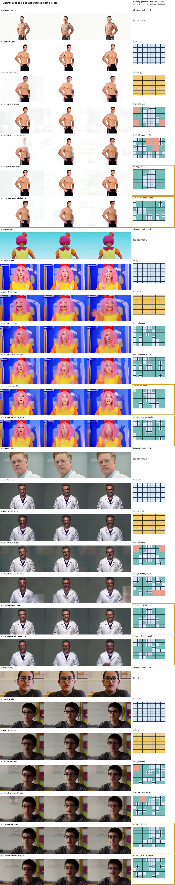

# LoT-H3 results and examples — 2026-10-10

This folder contains the benchmark tables and generated comparisons for the Level-of-Token H3 experiments. It contains no model weights; weights are published separately on [Hugging Face](https://huggingface.co/stale2000/LevelOfToken).

## What the results show

The r4 control and dense-preservation branches started from the same step-500 checkpoint and trained for 500 updates. On 24 untouched confirmation sources, the control and preserve teacher gaps were 0.292050 and 0.292138. Preserve-minus-control was +0.000088, with paired 95% interval [−0.001864, +0.002073]. Neither branch met the promotion threshold. See the [experiment history](benchmarks/experiment-history.md) and [benchmark index](benchmarks/README.md).

The selector screen compared entropy-based tile placement with a root-shuffled entropy control at a matched 50% token budget. Both use the same tile-size mix; the shuffled control changes where those tiles land. It used four validation prompts and did not receive untouched confirmation. Entropy is the preferred current candidate for this project, but the measured screens do not establish it as a confirmed benchmark winner.

## Visual comparisons

The entropy comparison preserves three sampled video frames for each method and appends that method’s matching t=0 tile grid. The gold outline marks the Entropy rows.

The full seven-latent-frame layouts and output videos are available under [`examples/entropy-selector`](examples/entropy-selector/). Control and preserve branch comparisons are under [`examples/control`](examples/control/) and [`examples/preserve`](examples/preserve/).

## Contents

- [`benchmarks/`](benchmarks/): pilot, r4 validation, and runtime CSVs plus experiment notes.
- [`examples/`](examples/): generated video samples, comparison sheets, and tile-layout masks.
